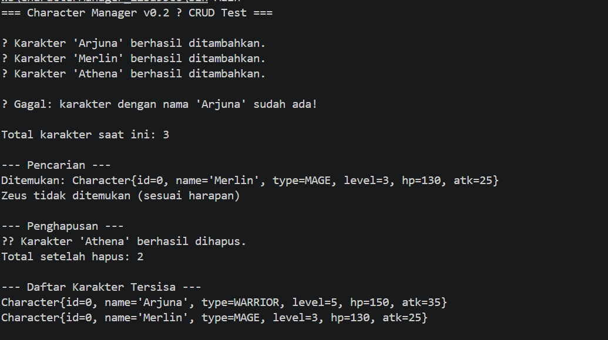

# Character Manager — TP3 (Java Visual SIH-6406)

## 1. Deskripsi Project

Character Manager merupakan aplikasi berbasis Java yang dibuat untuk memenuhi tugas TP3 AP3 Belajar Praktik pada mata kuliah Java Visual SIH-6406.

Aplikasi ini digunakan untuk membuat dan mengelola karakter menggunakan konsep Object-Oriented Programming (OOP). Pada project ini diterapkan konsep Encapsulation, Constructor, Getter, Setter, Enum, serta fitur tambahan Mana dan method `isAlive()` untuk memeriksa status karakter.

## 2. Fitur Program

Fitur yang terdapat dalam aplikasi Character Manager:

- Membuat objek karakter.
- Menentukan jenis karakter menggunakan Enum.
- Mengatur level karakter.
- Menghitung HP dan Attack Power.
- Menggunakan Getter dan Setter.
- Menampilkan informasi karakter menggunakan `toString()`.
- Menambahkan atribut Mana.
- Memeriksa status karakter menggunakan `isAlive()`.

## 3. Screenshot Output Program

Berikut merupakan hasil menjalankan aplikasi Character Manager melalui terminal Visual Studio Code.



Catatan: Pastikan screenshot yang dimasukkan sudah menampilkan hasil method `isAlive()` sesuai instruksi tugas.

## 4. Struktur Folder Project

```text
CharacterManager/
│
├── src/
│   └── com/
│       └── unpri/
│           └── charactermanager/
│               ├── model/
│               │   ├── Character.java
│               │   └── CharacterType.java
│               │
│               └── Main.java
│
├── docs/
│   └── screenshot-output.png
│
└── README.md
```
## 6. docs
[https://docs.google.com/document/d/1edhhAud6sHCkEDx_5WUBrPZcrv_R6AjY/edit?usp=drivesdk&ouid=117007323148153703738&rtpof=true&sd=true]

## 5. Identitas Mahasiswa

- Nama Lengkap:Shintya wulandari togatorop
- NIM: 253303621295


# Character Manager — TP3 (Java Visual SIH-6406)

## 1. Deskripsi Project

Character Manager merupakan aplikasi berbasis Java yang dibuat untuk memenuhi tugas TP3 AP3 Belajar Praktik pada mata kuliah Java Visual SIH-6406.

Aplikasi ini digunakan untuk membuat dan mengelola karakter menggunakan konsep Object-Oriented Programming (OOP). Pada project ini diterapkan konsep Encapsulation, Constructor, Getter, Setter, Enum, Composition, serta ArrayList untuk mengelola kumpulan objek karakter.

Project ini juga dilengkapi fitur CRUD (Create, Read, Update, Delete) untuk menambahkan, mencari, dan menghapus karakter serta menghitung jumlah karakter yang tersimpan.

## 2. Fitur Program

Fitur yang terdapat dalam aplikasi Character Manager:

- Membuat objek karakter.
- Menentukan jenis karakter menggunakan Enum.
- Mengatur level karakter.
- Menghitung HP dan Attack Power.
- Menggunakan Getter dan Setter.
- Menampilkan informasi karakter menggunakan `toString()`.
- Mengelola daftar karakter menggunakan ArrayList.
- Menambahkan karakter menggunakan `addCharacter()`.
- Mencegah penambahan karakter dengan nama duplikat.
- Mencari karakter menggunakan `findByName()`.
- Menghapus karakter menggunakan `removeCharacter()`.
- Menghitung jumlah karakter menggunakan `getTotalCharacters()`.
- Menampilkan seluruh karakter menggunakan `getAllCharacters()`.

## 3. Screenshot Output Program

Berikut merupakan hasil menjalankan aplikasi Character Manager v0.2 melalui terminal Visual Studio Code.


Hasil pengujian menunjukkan:
- Karakter Arjuna, Merlin, dan Athena berhasil ditambahkan.
- Sistem berhasil menolak karakter dengan nama duplikat.
- Pencarian karakter Merlin berhasil ditemukan.
- Karakter Zeus tidak ditemukan.
- Karakter Athena berhasil dihapus.
- Total karakter setelah penghapusan adalah 2.

## 4. Struktur Folder Project

```text
CharacterManager/
│
├── src/
│   ├── Main.java
│   │
│   └── com/
│       └── unpri/
│           └── charactermanager/
│               └── model/
│                   ├── Character.java
│                   ├── CharacterType.java
│                   └── CharacterManager.java
│
├── docs/
│   └── screenshot-output.png
│
└── README.md
```

## 5. Identitas Mahasiswa

- Nama Lengkap: Shintya Wulandari Togatorop
- NIM: 253303621295
- Mata Kuliah: Java Visual SIH-6406
- Tugas: TP3 AP3 Belajar Praktik

## 6. Dokumentasi

Link Google Docs:

https://docs.google.com/document/d/1edhhAud6sHCkEDx_5WUBrPZcrv_R6AjY/edit?usp=drivesdk

