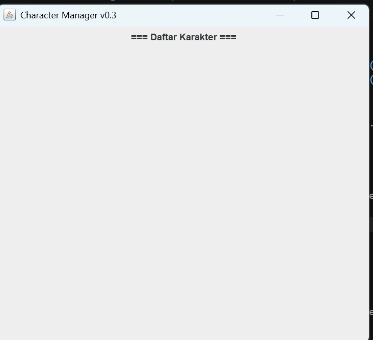
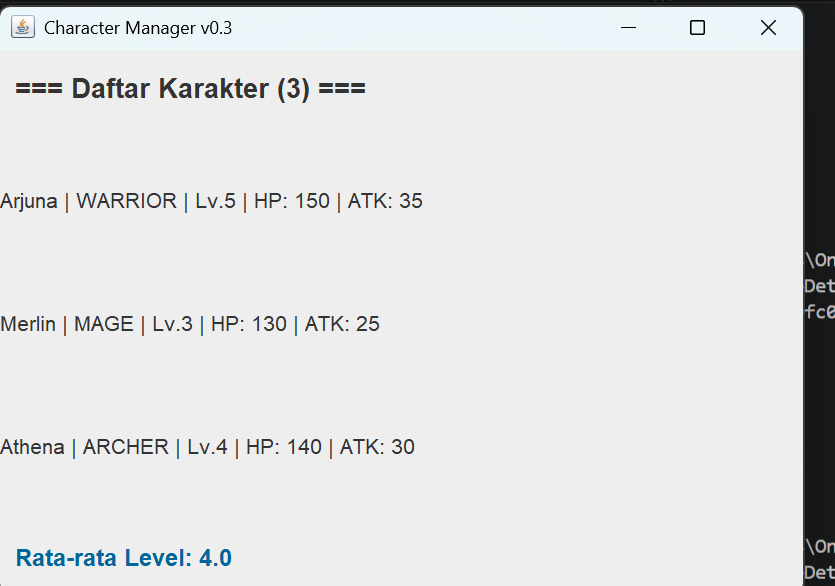
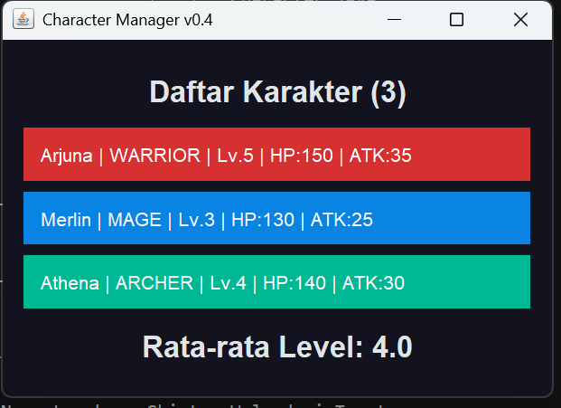
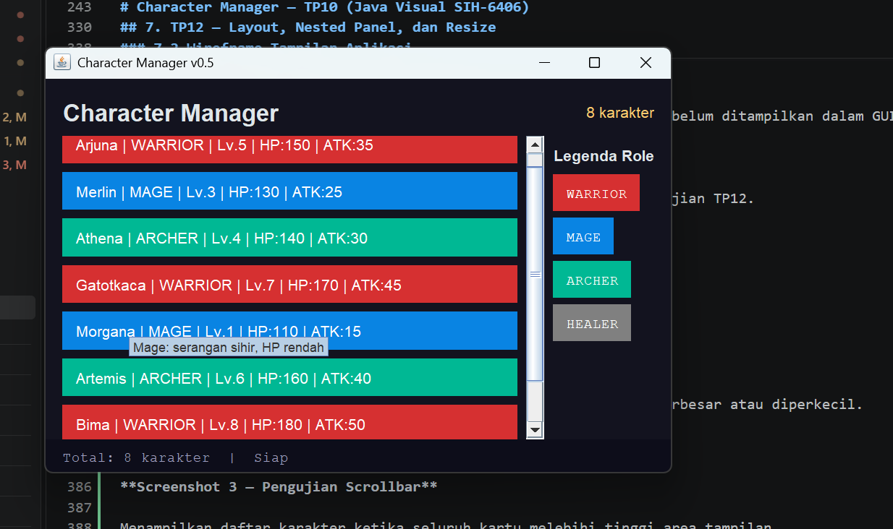
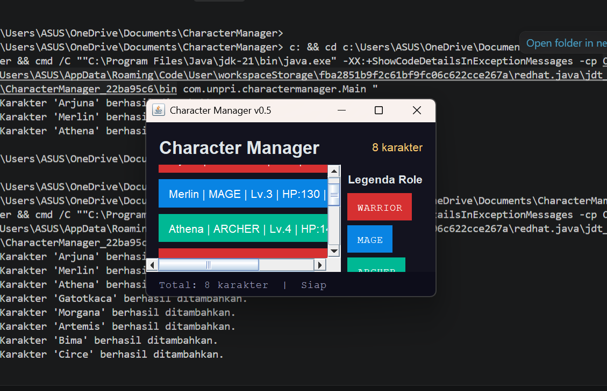
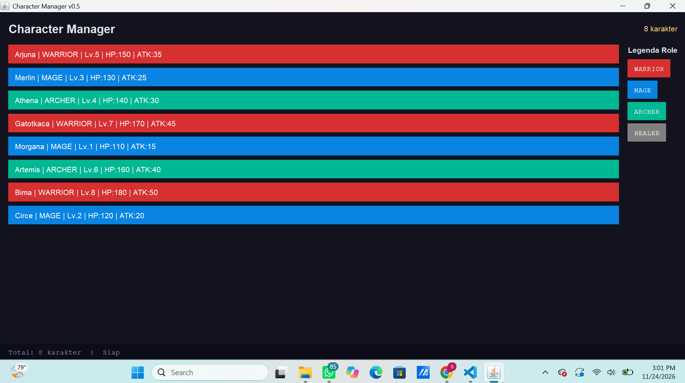
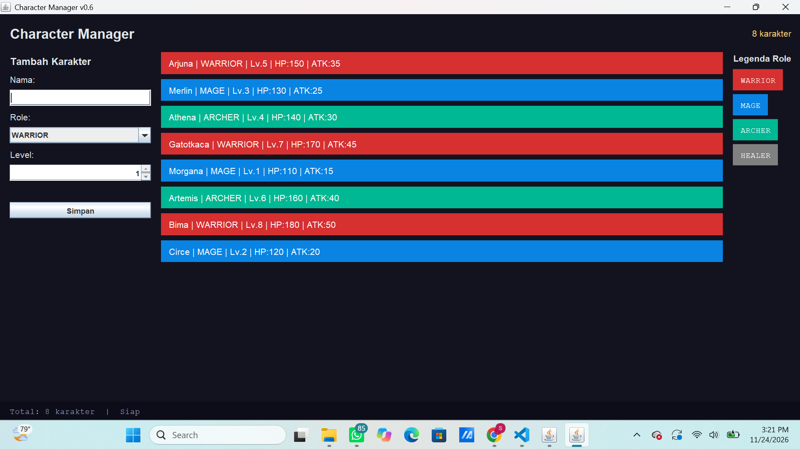

# Character Manager — TP3 (Java Visual SIH-6406)

## 1. Deskripsi Project

Character Manager merupakan aplikasi berbasis Java yang dibuat untuk memenuhi tugas TP3 AP3 Belajar Praktik pada mata kuliah Java Visual SIH-6406.

Aplikasi ini digunakan untuk membuat dan mengelola karakter menggunakan konsep Object-Oriented Programming (OOP). Pada project ini diterapkan konsep Encapsulation, Constructor, Getter, Setter, Enum, serta fitur tambahan Mana dan method `isAlive()` untuk memeriksa status karakter.

## 2. Fitur Program

Fitur yang terdapat dalam aplikasi Character Manager:

- Membuat objek karakter.
- Menentukan jenis karakter menggunakan Enum.
- Mengatur level karakter.
- Menghitung HP dan Attack Power.
- Menggunakan Getter dan Setter.
- Menampilkan informasi karakter menggunakan `toString()`.
- Menambahkan atribut Mana.
- Memeriksa status karakter menggunakan `isAlive()`.

## 3. Screenshot Output Program

Berikut merupakan hasil menjalankan aplikasi Character Manager melalui terminal Visual Studio Code.


Catatan: Pastikan screenshot yang dimasukkan sudah menampilkan hasil method `isAlive()` sesuai instruksi tugas.

## 4. Struktur Folder Project

```text
CharacterManager/
│
├── src/
│   └── com/
│       └── unpri/
│           └── charactermanager/
│               ├── model/
│               │   ├── Character.java
│               │   └── CharacterType.java
│               │
│               └── Main.java
│
├── docs/
│   └── screenshot-output.png
│
└── README.md
```
## 6. docs
[https://docs.google.com/document/d/1edhhAud6sHCkEDx_5WUBrPZcrv_R6AjY/edit?usp=drivesdk&ouid=117007323148153703738&rtpof=true&sd=true]

## 5. Identitas Mahasiswa

- Nama Lengkap:Shintya wulandari togatorop
- NIM: 253303621295


# Character Manager — TP3 (Java Visual SIH-6406)

## 1. Deskripsi Project

Character Manager merupakan aplikasi berbasis Java yang dibuat untuk memenuhi tugas TP3 AP3 Belajar Praktik pada mata kuliah Java Visual SIH-6406.

Aplikasi ini digunakan untuk membuat dan mengelola karakter menggunakan konsep Object-Oriented Programming (OOP). Pada project ini diterapkan konsep Encapsulation, Constructor, Getter, Setter, Enum, Composition, serta ArrayList untuk mengelola kumpulan objek karakter.

Project ini juga dilengkapi fitur CRUD (Create, Read, Update, Delete) untuk menambahkan, mencari, dan menghapus karakter serta menghitung jumlah karakter yang tersimpan.

## 2. Fitur Program

Fitur yang terdapat dalam aplikasi Character Manager:

- Membuat objek karakter.
- Menentukan jenis karakter menggunakan Enum.
- Mengatur level karakter.
- Menghitung HP dan Attack Power.
- Menggunakan Getter dan Setter.
- Menampilkan informasi karakter menggunakan `toString()`.
- Mengelola daftar karakter menggunakan ArrayList.
- Menambahkan karakter menggunakan `addCharacter()`.
- Mencegah penambahan karakter dengan nama duplikat.
- Mencari karakter menggunakan `findByName()`.
- Menghapus karakter menggunakan `removeCharacter()`.
- Menghitung jumlah karakter menggunakan `getTotalCharacters()`.
- Menampilkan seluruh karakter menggunakan `getAllCharacters()`.

## 3. Screenshot Output Program

Berikut merupakan hasil menjalankan aplikasi Character Manager v0.2 melalui terminal Visual Studio Code.


Hasil pengujian menunjukkan:
- Karakter Arjuna, Merlin, dan Athena berhasil ditambahkan.
- Sistem berhasil menolak karakter dengan nama duplikat.
- Pencarian karakter Merlin berhasil ditemukan.
- Karakter Zeus tidak ditemukan.
- Karakter Athena berhasil dihapus.
- Total karakter setelah penghapusan adalah 2.

## 4. Struktur Folder Project

```text
CharacterManager/
│
├── src/
│   ├── Main.java
│   │
│   └── com/
│       └── unpri/
│           └── charactermanager/
│               └── model/
│                   ├── Character.java
│                   ├── CharacterType.java
│                   └── CharacterManager.java
│
├── docs/
│   └── screenshot-output.png
│
└── README.md
```

## 5. Identitas Mahasiswa

- Nama Lengkap: Shintya Wulandari Togatorop
- NIM: 253303621295
- Mata Kuliah: Java Visual SIH-6406
- Tugas: TP3 AP3 Belajar Praktik

## 6. Dokumentasi

Link Google Docs:

https://docs.google.com/document/d/1edhhAud6sHCkEDx_5WUBrPZcrv_R6AjY/edit?usp=drivesdk


# Character Manager — TP3 (Java Visual SIH-6406)

## 1. Deskripsi Project

Character Manager merupakan aplikasi berbasis Java yang dibuat untuk memenuhi tugas TP3 AP3 Belajar Praktik pada mata kuliah Java Visual SIH-6406.

Aplikasi ini digunakan untuk membuat dan mengelola karakter menggunakan konsep Object-Oriented Programming (OOP). Pada project ini diterapkan konsep Encapsulation, Constructor, Getter, Setter, Enum, Composition, ArrayList, dan GUI menggunakan Java Swing.

Project ini dikembangkan secara bertahap mulai dari pengelolaan karakter, fitur CRUD, hingga tampilan GUI. Pada pengembangan terbaru, aplikasi dilengkapi JLabel statistik yang menampilkan rata-rata level seluruh karakter dengan menerapkan prinsip MVC (Model-View-Controller).

## 2. Fitur Program

Fitur yang terdapat dalam aplikasi Character Manager:

- Membuat objek karakter.
- Menentukan jenis karakter menggunakan Enum.
- Mengatur level karakter.
- Menghitung HP dan Attack Power.
- Menggunakan Getter dan Setter.
- Menampilkan informasi karakter menggunakan `toString()`.
- Menambahkan atribut Mana.
- Memeriksa status karakter menggunakan `isAlive()`.
- Mengelola kumpulan karakter menggunakan ArrayList.
- Menambahkan karakter menggunakan `addCharacter()`.
- Mencegah penambahan karakter dengan nama duplikat.
- Mencari karakter menggunakan `findByName()`.
- Menghapus karakter menggunakan `removeCharacter()`.
- Menghitung jumlah karakter menggunakan `getTotalCharacters()`.
- Menampilkan seluruh karakter menggunakan `getAllCharacters()`.
- Menampilkan daftar karakter menggunakan Java Swing.
- Menampilkan jumlah karakter pada GUI.
- Menghitung rata-rata level menggunakan `getAverageLevel()`.
- Menampilkan statistik rata-rata level menggunakan JLabel.

## 3. Screenshot Output Program

Berikut merupakan hasil menjalankan aplikasi Character Manager melalui Visual Studio Code.





Hasil pengujian program:
- Karakter Arjuna berhasil ditambahkan.
- Karakter Merlin berhasil ditambahkan.
- Karakter Athena berhasil ditambahkan.
- Data karakter berhasil dikelola menggunakan CharacterManager.
- GUI menampilkan daftar karakter.
- JLabel menampilkan statistik rata-rata level karakter.

Contoh perhitungan rata-rata level:

- Arjuna: Level 5
- Merlin: Level 3
- Athena: Level 4

Rata-rata Level: 4.0

## 4. Struktur Folder Project

```text
CharacterManager/
│
├── src/
│   ├── Main.java
│   │
│   └── com/
│       └── unpri/
│           └── charactermanager/
│               ├── model/
│               │   ├── Character.java
│               │   ├── CharacterType.java
│               │   └── CharacterManager.java
│               │
│               └── view/
│                   └── MainWindow.java
│
├── docs/
│   └── screenshot-output.png
│
└── README.md
```

## 5. Identitas Mahasiswa

- Nama Lengkap: Shintya Wulandari Togatorop
- NIM: 253303621295
- Mata Kuliah: Java Visual SIH-6406
- Tugas: TP3 AP3 Belajar Praktik

## 6. Dokumentasi

Link Google Docs:

[TP8](https://docs.google.com/document/d/18pYypg2MKJxcw0luj9x-QpVEDYb7qFGA/edit?usp=drivesdk&ouid=117007323148153703738&rtpof=true&sd=true)

## 7. Kes--00
mpulan

Aplikasi Character Manager berhasil dikembangkan menggunakan bahasa pemrograman Java dengan menerapkan konsep Object-Oriented Programming (OOP).

Pengembangan aplikasi mencakup pengelolaan data karakter, fitur CRUD, serta tampilan GUI menggunakan Java Swing. Selain itu, fitur statistik rata-rata level ditambahkan untuk menampilkan informasi karakter secara lebih ringkas.

Perhitungan rata-rata dilakukan pada bagian Model, sedangkan MainWindow bertugas menampilkan hasil melalui JLabel. Dengan demikian, aplikasi menerapkan prinsip pemisahan tanggung jawab dalam MVC.

# Character Manager — TP10 (Java Visual SIH-6406)

## 1. Deskripsi Project

Character Manager merupakan aplikasi berbasis Java yang dibuat untuk memenuhi tugas TP3 AP3 Belajar Praktik pada mata kuliah Java Visual SIH-6406.

Aplikasi ini digunakan untuk mengelola dan menampilkan daftar karakter menggunakan konsep Object-Oriented Programming (OOP). Pada Sprint #4, aplikasi dikembangkan menggunakan Java Swing untuk membuat tampilan Graphical User Interface (GUI) yang lebih menarik dan interaktif.

Project ini menerapkan konsep Encapsulation, Constructor, Getter, Setter, Enum, Composition, ArrayList, serta Model-View-Controller (MVC). Selain itu, aplikasi menggunakan AppTheme sebagai pusat pengaturan warna, font, dan tampilan kartu karakter.

## 2. Fitur Program

Fitur yang terdapat dalam aplikasi Character Manager:

- Membuat objek karakter.
- Menentukan jenis karakter menggunakan Enum.
- Mengatur level karakter.
- Menghitung HP dan Attack Power.
- Menggunakan Getter dan Setter.
- Mengelola daftar karakter menggunakan ArrayList.
- Menambahkan karakter menggunakan `addCharacter()`.
- Mencegah penambahan karakter dengan nama duplikat.
- Mencari karakter menggunakan `findByName()`.
- Menghapus karakter menggunakan `removeCharacter()`.
- Menghitung jumlah karakter menggunakan `getTotalCharacters()`.
- Menghitung rata-rata level menggunakan `getAverageLevel()`.
- Menampilkan daftar karakter menggunakan Java Swing.
- Menampilkan setiap karakter dalam kartu menggunakan JLabel.
- Menggunakan GridLayout untuk menyusun tampilan karakter.
- Menggunakan AppTheme untuk mengatur warna dan font aplikasi.
- Menampilkan statistik rata-rata level karakter.

## 3. Screenshot Output Program

Berikut merupakan dokumentasi proses menjalankan aplikasi Character Manager v0.4 melalui terminal Visual Studio Code.



Hasil pengujian yang ditampilkan:
- Karakter Arjuna berhasil ditambahkan.
- Karakter Merlin berhasil ditambahkan.
- Karakter Athena berhasil ditambahkan.

Catatan: Screenshot terminal menunjukkan proses penambahan karakter. Screenshot tampilan GUI perlu ditambahkan setelah aplikasi berhasil dijalankan tanpa error.

## 4. Struktur Folder Project

```text
CharacterManager/
│
├── src/
│   └── com/
│       └── unpri/
│           └── charactermanager/
│               │
│               ├── Main.java
│               │
│               ├── model/
│               │   ├── Character.java
│               │   ├── CharacterType.java
│               │   └── CharacterManager.java
│               │
│               └── view/
│                   ├── MainWindow.java
│                   └── AppTheme.java
│
├── docs/
│   └── screenshot-output.png
│
└── README.md
```

## 5. Identitas Mahasiswa

- Nama Lengkap: Shintya Wulandari Togatorop
- NIM: 253303621295
- Mata Kuliah: Java Visual SIH-6406
- Tugas: TP3 AP3 Belajar Praktik
- Sprint: Sprint #4

## 6. Dokumentasi

Link Google Docs:

[tp10](https://docs.google.com/document/d/1IAlHO5KRRHe2HafUHYF2cveF6CaUUOAT/edit?usp=drivesdk&ouid=117007323148153703738&rtpof=true&sd=true)


## 7. TP12 — Layout, Nested Panel, dan Resize

### 7.1 Deskripsi TP12

Pada TP12, aplikasi Character Manager dikembangkan dengan memperhatikan struktur layout dan panel bersarang (Nested Panel) menggunakan Java Swing.

Tujuan pengembangan ini adalah membuat tampilan aplikasi lebih teratur, memudahkan pengelolaan komponen GUI, serta memastikan tampilan tetap nyaman digunakan ketika ukuran jendela diperbesar atau diperkecil.

### 7.2 Wireframe Tampilan Aplikasi

Berikut merupakan rancangan wireframe aplikasi Character Manager:

```text
+------------------------------------------+
|           CHARACTER MANAGER              |
+------------------------------------------+
|                                          |
|              DAFTAR KARAKTER             |
|                                          |
|  +------------------------------------+  |
|  | Arjuna | WARRIOR | Lv.5             |  |
|  +------------------------------------+  |
|                                          |
|  +------------------------------------+  |
|  | Merlin | MAGE | Lv.3                |  |
|  +------------------------------------+  |
|                                          |
|  +------------------------------------+  |
|  | Athena | ARCHER | Lv.4              |  |
|  +------------------------------------+  |
|                                          |
|             SCROLLBAR                   |
|                                          |
+------------------------------------------+
|             INFORMASI                    |
+------------------------------------------+
```

Wireframe ini menggambarkan rancangan susunan komponen aplikasi sebelum ditampilkan dalam GUI.

### 7.3 Screenshot Aplikasi

Berikut dokumentasi tampilan aplikasi Character Manager pada pengujian TP12.

**Screenshot 1 — Tampilan Awal**

Menampilkan aplikasi ketika pertama kali dijalankan.



**Screenshot 2 — Tampilan Setelah Resize**

Menampilkan perubahan tampilan aplikasi ketika ukuran jendela diperbesar atau diperkecil.



**Screenshot 3 — Pengujian Scrollbar**

Menampilkan daftar karakter ketika seluruh kartu melebihi tinggi area tampilan.



Catatan: Ganti gambar di atas dengan screenshot hasil pengujian sebenarnya.

### 7.4 Tabel Pengamatan Resize

Pengujian dilakukan untuk mengetahui perilaku komponen aplikasi ketika ukuran jendela berubah.

| No. | Pengujian | Prediksi | Hasil Pengamatan |
|---|---|---|---|
| 1 | Ukuran jendela diperbesar | Komponen menyesuaikan ruang yang tersedia | Isi sesuai hasil pengujian |
| 2 | Ukuran jendela diperkecil | Komponen tetap tersusun dengan baik | Isi sesuai hasil pengujian |
| 3 | Jumlah karakter bertambah | Scrollbar muncul jika konten melebihi viewport | Isi sesuai hasil pengujian |
| 4 | Scroll ke bawah | Karakter berikutnya dapat dilihat | Isi sesuai hasil pengujian |

### 7.5 Penjelasan Struktur Nested Panel

Struktur aplikasi Character Manager menggunakan konsep Nested Panel, yaitu panel yang ditempatkan di dalam panel lainnya. JFrame berfungsi sebagai jendela utama yang menampung panel utama sebagai tempat penyusunan komponen aplikasi. Panel utama dapat dibagi menjadi beberapa panel tambahan untuk memisahkan bagian judul, daftar karakter, dan informasi statistik. Dengan struktur tersebut, setiap bagian aplikasi lebih mudah diatur dan dikembangkan tanpa mengganggu bagian lainnya.

### 7.6 Alasan Penggunaan Panel Tambahan dan Layout

Panel tambahan digunakan untuk memisahkan komponen berdasarkan fungsinya agar tampilan aplikasi lebih terorganisir dan mudah diperbaiki. Penggunaan JPanel juga memudahkan penerapan layout yang berbeda pada setiap bagian aplikasi.

Layout Manager dipilih agar ukuran dan posisi komponen dapat menyesuaikan perubahan ukuran jendela. Penggunaan setLayout(null) dan setBounds() tidak dipilih karena posisi komponen harus diatur secara manual dan kurang fleksibel ketika ukuran jendela berubah.

### 7.7 Kesimpulan TP12

Melalui TP12, aplikasi Character Manager dikembangkan dengan memperhatikan struktur panel bersarang, penggunaan Layout Manager, dan pengujian resize. Pengujian ini membantu memastikan komponen GUI tersusun dengan lebih rapi dan daftar karakter dapat ditampilkan dengan bantuan scrollbar ketika jumlah karakter bertambah.

### 7.8 Dokumentasi Google Docs — Bagian D

Link Google Docs:

[tp12](https://docs.google.com/document/d/1gE30_5UEa4Av0FmvYBtIKqcn0SLy1VtE/edit?usp=drivesdk&ouid=117007323148153703738&rtpof=true&sd=true)


# TP14 — Komponen Input & Validasi

## Character Manager Sprint #6

### A. Implementasi Form Input

Aplikasi menggunakan tiga komponen input:
- JTextField untuk memasukkan nama karakter.
- JComboBox untuk memilih role karakter.
- JSpinner untuk menentukan level karakter dari 1 sampai 99.

Validasi dilakukan sebelum data dikirim ke Model.
Nama dibersihkan menggunakan trim() dan diperiksa
berdasarkan kelengkapan, panjang, format, serta keunikan.

### B. Validasi Tambahan

1. MAGE tidak boleh memiliki level di atas 60.
   Aturan ditempatkan pada Model agar berlaku untuk
   semua sumber data.

2. Nama tidak boleh memiliki spasi berulang.
   Aturan ditempatkan pada View karena berkaitan
   dengan format input pengguna.

3. Jumlah karakter maksimal 20.
   Aturan ditempatkan pada Model agar batas jumlah
   data tetap terjaga.

### C. Tabel Pengujian

| No | Input | Hasil Diharapkan | Hasil Nyata | Lapisan |
|---|---|---|---|---|
| 1 | Nama kosong | Ditolak | Isi setelah tes | View |
| 2 | Nama terlalu pendek | Ditolak | Isi setelah tes | View |
| 3 | Nama angka | Ditolak | Isi setelah tes | View |
| 4 | Nama duplikat | Ditolak | Isi setelah tes | Model |
| 5 | Spasi berulang | Ditolak | Isi setelah tes | View |
| 6 | MAGE level 60 | Diterima | Isi setelah tes | Model |
| 7 | MAGE level 61 | Ditolak | Isi setelah tes | Model |
| 8 | Karakter ke-21 | Ditolak | Isi setelah tes | Model |

### D. Screenshot



### E. Struktur Panel dan Kompromi Sementara

CharacterFormPanel bertugas menerima input dan melakukan
validasi awal sebelum data dikirim ke CharacterManager.
CharacterManager mengelola data karakter dan Character
menjaga aturan bisnis. MainWindow menampilkan daftar
karakter dan memperbarui tampilan melalui refreshList().

ActionListener yang digunakan masih sederhana dan
pemanggilan manager.addCharacter() masih dilakukan
langsung dari View. Pendekatan ini digunakan sebagai
kompromi sementara agar proses input dan validasi dapat
berjalan. Pada pengembangan berikutnya, pemisahan
tanggung jawab dapat diperbaiki melalui pola Controller.

### F. Google Docs — Bagian D

Masukkan link Google Docs analisis TP14 di sini:
[TP14](https://docs.google.com/document/d/1qm_9ZPBCe5YHnQ5VJYWO9k3ZIH9q9pxa/edit?usp=drivesdk&ouid=117007323148153703738&rtpof=true&sd=true)
